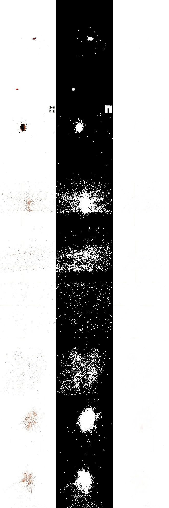
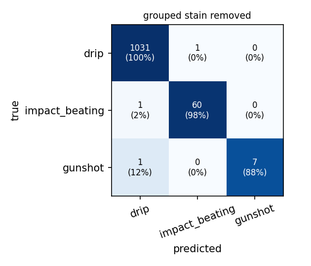

# BSARA: Bloodstain Pattern Analysis with AI (and how it fooled me)

BSARA classifies bloodstain photographs into three pattern types (passive **drip**, blunt-force
**impact** spatter, and **gunshot** backspatter) using a YOLOv8 model fine-tuned on public
laboratory datasets. It includes a Streamlit demo.

The more important part of the project is the evaluation. My first version reported **99.5% mAP50**
on drip stains. When I audited it, I found train/validation leakage, a validation set too small
to mean anything and, most importantly, that the datasets let a model classify bloodstains
**without looking at the blood**. With every blood pixel removed, the classifier still gets
**1,098 / 1,101 images right**. This README documents both versions, the tests that exposed the
problem, and what a valid dataset would need.

> ⚠️ **Not a forensic tool.** Bloodstain pattern analysis has contributed to wrongful convictions
> because of overconfident, poorly validated interpretation. A model that hides the same problem
> behind a high accuracy number would make that worse. Nothing here is suitable for casework.

## Why this problem

Bloodstain pattern analysis (BPA) is used to reconstruct violent events, but it relies heavily on
subjective expert judgment, and different analysts can reach different conclusions from the same
evidence. An objective, reproducible classifier could help, *if* it actually measures the stain.

## v1: what I built first (`legacy/v1_detection/`)

* 1,101 images from three open datasets (drip 1,032 · impact 61 · gunshot 8), resized to 640×640
* 108 images labelled with bounding boxes (50 drip by hand in Label Studio; impact and gunshot
  automatically from the largest dark blob)
* YOLOv8n detector fine-tuned with transfer learning, 80/20 random split, Streamlit app
* Reported: **mAP50 0.52 overall, 0.995 drip, 0.55 impact, 0.02 gunshot**

## The audit: three problems

**1. The same drop was in training and validation.** The drip dataset ships 3–5 versions of every
drop (original, edited, cropped, red-channel, contrast-enhanced). There are 1,032 drip images but
only **300 physical drops**. A random image-level split places versions of the same drop on both
sides. With the v1-style split, **88.5% of validation images share a drop with the training set.**
`bsara/build_index.py` recovers which drop every file came from and writes `data/index.csv`.

**2. The validation set was too small to mean anything.** v1 validated on 22 images, with a
single gunshot image. v2 uses 4-fold group-aware cross-validation over all 1,101 images and reports
mean ± std across folds.

**3. Each class came from a different lab.** Drip, impact and gunshot images come from three
different datasets with different paper, scanners, lighting and framing. A model can separate
the classes by recognising *the dataset*, not the bloodstain. To test this, I inpainted every
blood pixel away (`bsara/stain_removal.py`) and retrained:



*Left: original · middle: detected blood mask · right: blood removed. Only paper and lighting
remain.*

## v2 results (`bsara/`)

Image-level classification (YOLOv8n-cls, COCO-pretrained backbone, 224 px, 15 epochs,
minority-class oversampling), 4-fold cross-validation with identical settings across conditions.
Balanced accuracy is the headline metric because 94% of images are drip.

| Condition | Balanced acc. | Macro-F1 | Recall drip | Recall impact | Recall gunshot |
|---|---|---|---|---|---|
| CNN, v1-style image split (leaky) | 0.99 ± 0.01 | 0.98 ± 0.03 | 1.00 ± 0.00 | 0.98 ± 0.03 | 1.00 ± 0.00 |
| CNN, group-aware split | 0.99 ± 0.01 | 0.98 ± 0.03 | 1.00 ± 0.00 | 0.98 ± 0.03 | 1.00 ± 0.00 |
| **CNN, group-aware split, blood removed** | **0.95 ± 0.07** | **0.97 ± 0.05** | 1.00 ± 0.00 | 0.98 ± 0.03 | 0.88 ± 0.22 |
| Colour statistics + logistic regression | 0.74 ± 0.13 | 0.69 ± 0.08 | 1.00 ± 0.00 | 0.72 ± 0.08 | 0.50 ± 0.35 |
| Colour statistics, blood removed | 0.86 ± 0.08 | 0.54 ± 0.03 | 0.84 ± 0.01 | 0.85 ± 0.15 | 0.88 ± 0.22 |

Mean ± std over 4 folds, 1,101 images. Per-image predictions and confusion matrices are in
[`results/`](results/).



**What this means:**

* **The model is near-perfect, and that is the problem.** With every blood pixel inpainted
  away, the CNN still classifies **1,098 of 1,101 images** correctly. It does not need the stain.
  It recognises which dataset an image came from, and in these datasets the dataset *is* the
  label.
* **Even a 30-number colour summary nearly does it.** Logistic regression on background colour
  statistics of blood-free images reaches 0.86 balanced accuracy.
* **Fixing the split changed nothing here,** but only because the shortcut is so strong. Grouping
  by drop removed an 88.5% train/validation overlap, yet the scores stayed the same because the
  model never needed to memorise individual drops. On a harder, source-balanced dataset, the
  leak would inflate results directly. That is why the group-aware split stays.
* **So these datasets cannot tell us whether a model has learned bloodstain morphology.** The
  v1 99.5% mAP50 for drip, and any similar number on these data, should not be read as evidence
  of forensic capability.

## What I learned

* **Audit the split before you trust the score.** Near-duplicates are common in medical and
  forensic datasets (multiple scans, crops and edits of one specimen). Split by specimen, not file.
* **Run a "can it work without the signal?" control.** Removing the blood and checking whether the
  model still succeeds is a cheap test, and it changed the conclusion of this project.
* **Report the metrics that match the question.** With a 1,032 / 61 / 8 class split, accuracy and
  mAP on the majority class hide almost everything that matters.

## Limitations

* Lab stains on clean paper, not crime scenes. Real substrates (fabric, carpet, wallpaper),
  lighting and mixed patterns are untested.
* 8 gunshot scans cannot support a real gunshot class.
* Class and data source are perfectly confounded, so these datasets cannot by themselves show that
  any model has learned bloodstain morphology.
* The full-resolution impact scans were no longer available locally, so all images use the v1
  640×640 (aspect-distorted) versions. This destroys fine backspatter detail.

## What a valid v3 needs

1. **Each pattern type created in the same lab, on the same substrates, photographed the same
   way.** This removes the source shortcut by design.
2. Many more gunshot and impact specimens, split by specimen.
3. Full-resolution, aspect-preserving tiles instead of squashed 640×640 images.
4. Stain-level morphology (ellipse fitting, impact angle, area of origin) rather than whole-image
   classification, which is closer to what analysts actually report.

## Reproduce

```bash
pip install -r requirements.txt
# put the datasets in data/raw/ (see DATA.md), then:
python legacy/v1_detection/preprocess.py   # 640x640 images -> data/processed/
python -m bsara.build_index                 # image -> drop/scan groups -> data/index.csv
python -m bsara.cv_classify                 # 3 conditions x 4 folds (~1 h on an RTX 4050)
python -m bsara.shortcut_baseline           # colour-statistics baseline
python -m bsara.metrics                     # results/metrics.md + confusion matrices
python -m bsara.train_final                 # demo model -> models/bsara_cls_v2.pt
streamlit run app.py
```

## Repository layout

```
bsara/                 v2 pipeline: indexing, grouped CV, shortcut tests, metrics
legacy/v1_detection/   original v1 detection pipeline (kept for comparison)
results/               metrics table, confusion matrices, per-image predictions
data/index.csv         file -> class -> drop/scan group (no images)
app.py                 Streamlit demo (v2 classifier)
```

## Data and license

Code: MIT (see `LICENSE`). Datasets belong to their authors and are **not** included. See
[DATA.md](DATA.md) for sources and citations.
